


**Viloyat hokimligi uchun sun'iy intellekt yordamchisi:** hokim ovoz bilan so'raydi, javob vaziyat ekranida va ovozda chiqadi. Xodimlar uchun AI kabinet, ofis hujjatlari, mobil ilova va ichki qo'ng'iroq ham shu tizimda, hammasi hokimlik serverida ishlaydi.

---

## Bir qarashda

Ish shunday ketadi:

1. **Hokim so'raydi:** «Gulnoza, Zomin tumani kesimini ko'rsat».
2. **Nutq serverda matnga aylanadi.** O'zbekcha nutqni serverdagi Vosk modeli taniydi, ovoz hokimlikdan tashqariga chiqmaydi.
3. **Javob ekranda va ovozda.** Vaziyat ekrani shu savolga mos bloklardan o'zi yig'iladi, Gulnoza esa xulosani ovoz chiqarib aytadi.
4. **Topshiriq mas'ulga yetadi.** Kerak bo'lsa topshiriq beriladi, mas'ul uni mobil ilovada ko'radi, muddati yaqinlashsa eslatma oladi.

## Asosiy imkoniyatlar

| | |
|---|---|
| 🎙️ **Ovozli muloqot** | «Gulnoza» deb chaqiriladi. Asosiy til o'zbekcha, mehmonlar bilan rus va ingliz tilida ham gaplashadi. Javob ovozda ham, ekranda ham chiqadi |
| 🧩 **Generativ vaziyat ekrani** | Oldindan chizilgan qotgan ekranlar yo'q. Har savolga ekran bloklardan o'zi yig'iladi: topshiriqlar, tumanlar kesimi, eksport, investitsiya, murojaatlar, xarita. «Orqaga», «ikkinchisini och» kabi buyruqlar bilan boshqariladi |
| ✅ **Ijro nazorati** | Faol va muddati o'tgan topshiriqlar, mas'ul, bajarilish foizi, kunlik dinamika |
| ⏰ **Avtonom ish tartibi** | 08:00 da ertalabki brifing, 08:30 da muddati yaqin topshiriqlar eslatmasi, 23:50 da kunlik holat surati, juma 17:00 da ijro intizomi hisoboti (Excel). Vaqtlar sozlamada o'zgaradi |
| 🗺️ **Marshrut** | «Toshkentdan Gulistongacha yo'l» kabi savolga yo'l xaritada chiziladi, masofa va vaqt aytiladi. Hisoblash o'z OSRM serverida bajariladi |
| 🗂️ **Xodim kabineti** | To'rt ish: rasmiy hujjat (.docx va .pdf), Excel jadval (formula, diagramma), yig'ilish bayonnomasi (audiodan protokol), kelgan hujjat tahlili va javob loyihasi. Hujjat brauzerdagi ONLYOFFICE muharririda ochiladi, yonida AI paneli turadi |
| 🔢 **Raqam taxmin qilinmaydi** | Bayonnomada aniq eshitilmagan son `[?]` bo'lib qoladi va hujjat oxiridagi «xodim tekshirishi kerak» ro'yxatiga tushadi |
| 📱 **Mobil ilova** | Veb-ilova (PWA) va Android. Bo'limlari: Bugun, Topshiriq, Gulnoza, Murojaat, Aloqa. Ilovadan Gulnozaga ovoz yoki matn bilan savol beriladi |
| 📞 **Ichki qo'ng'iroq** | Xodimlar o'rtasidagi ovozli qo'ng'iroq o'z TURN relesi orqali o'tadi, tashqi STUN serveri ishlatilmaydi |
| 🤖 **Telegram bot** | Fuqaro murojaatlarini o'zbek va rus tilida qabul qiladi |
| 🛡️ **Boshqaruv markazi** | Foydalanuvchilar, sessiyalar, sozlamalar va AI xarajati (token hisobi) bitta panelda |
| 💾 **Uzilishga chidamli** | Tashqi AI xizmati javob bermasa, serverdagi o'z modeli javob beradi. Ma'lumotlar har kecha zaxiralanadi, kiosk yangi kod joylanganda o'zi yangilanadi |

## Ekranlar

<table>
<tr>
<td width="50%">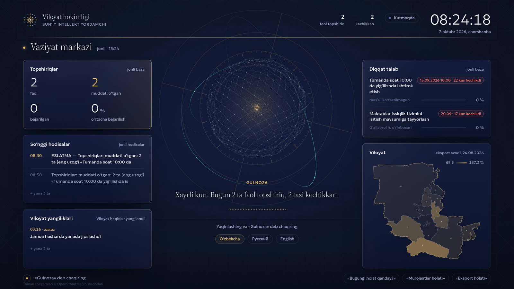 <b>Vaziyat markazi</b> — hokim ekrani: topshiriqlar, hodisalar, diqqat talab qiladiganlar, viloyat xaritasi</td>
<td width="50%">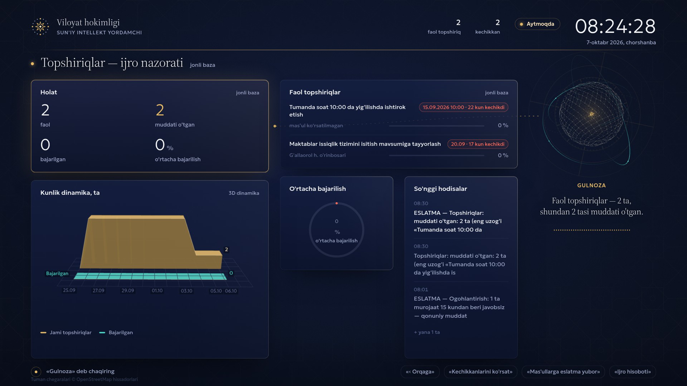 <b>Topshiriqlar</b> — ijro nazorati va kunlik dinamika</td>
</tr>
<tr>
<td>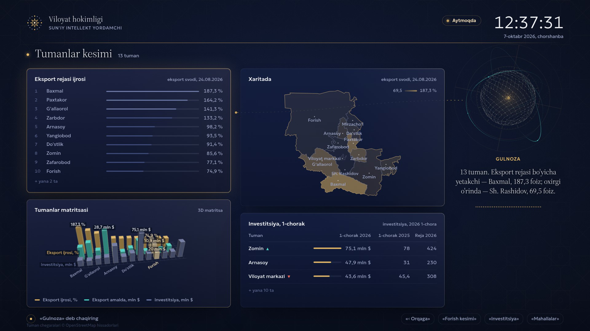 <b>Tumanlar kesimi</b> — eksport ijrosi, investitsiya, 3D matritsa</td>
<td>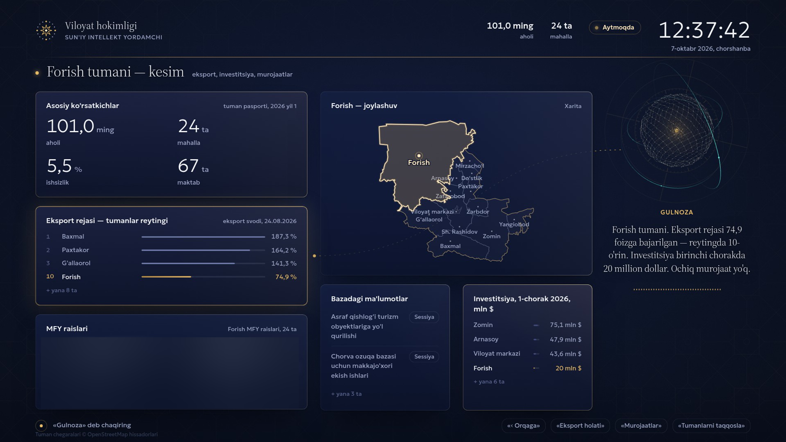 <b>Tuman kartasi</b> — asosiy ko'rsatkichlar va joylashuv (shaxsiy ma'lumot yopilgan)</td>
</tr>
<tr>
<td>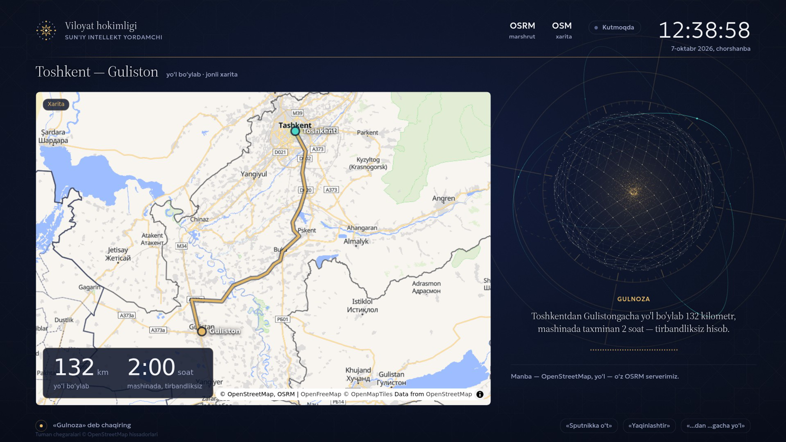 <b>Marshrut</b> — o'z OSRM serveri, masofa va yo'l vaqti</td>
<td>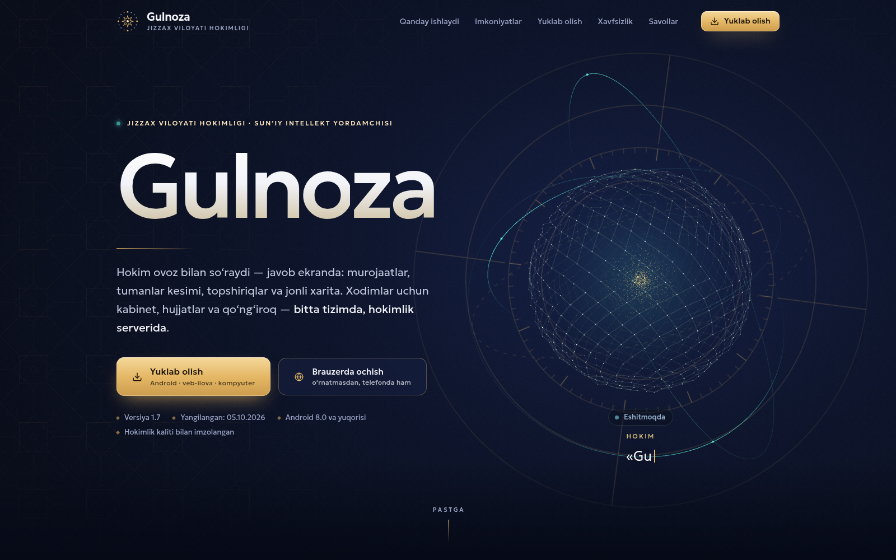 <b>Ochiq sahifa</b> — ilovani yuklab olish va brauzerda ochish</td>
</tr>
<tr>
<td>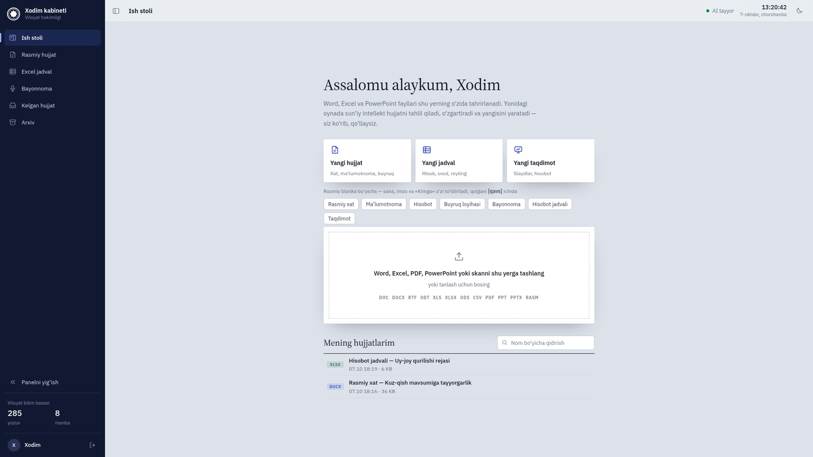 <b>Xodim kabineti</b> — ish stoli, hujjat shablonlari</td>
<td>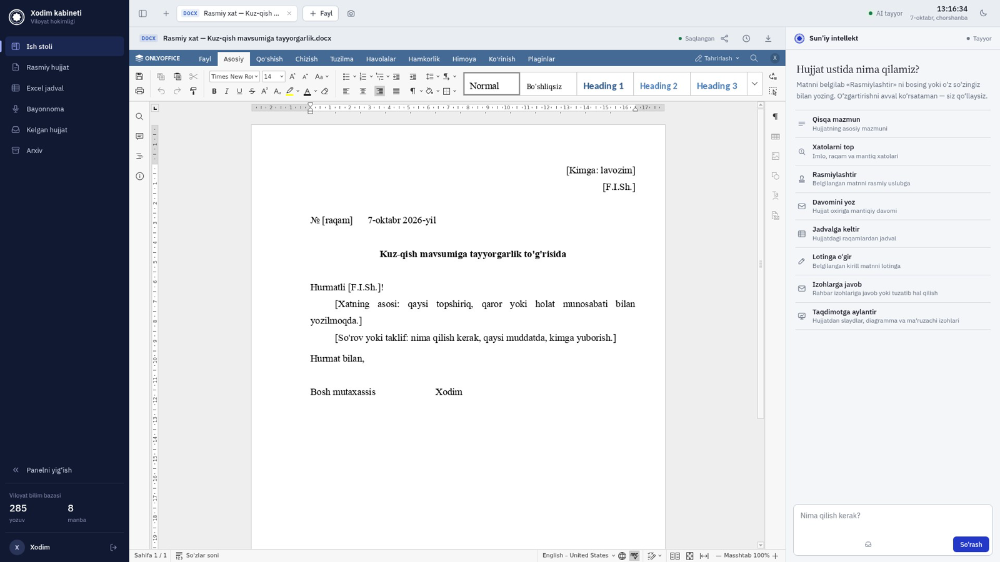 <b>Rasmiy hujjat</b> — ONLYOFFICE muharriri va AI paneli</td>
</tr>
<tr>
<td>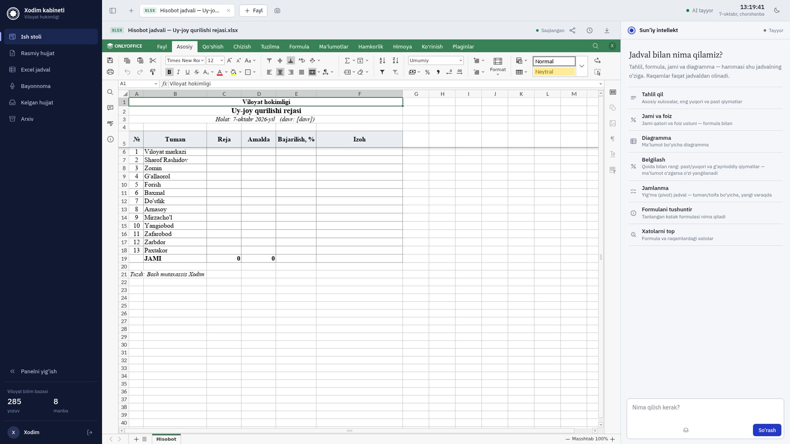 <b>Excel jadval</b> — tahlil, formula, diagramma</td>
<td>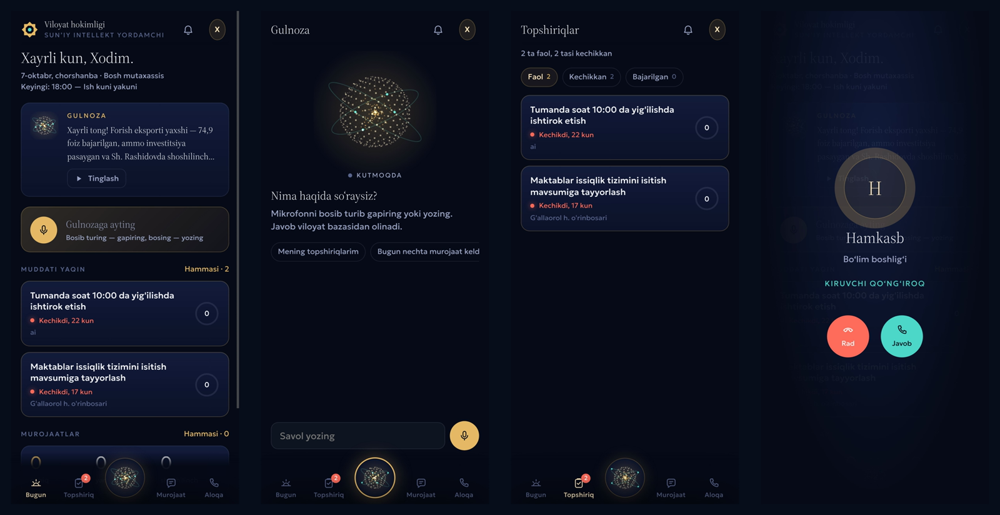 <b>Mobil ilova</b> — Bugun, Gulnoza, Topshiriqlar, kiruvchi qo'ng'iroq</td>
</tr>
</table>

> Kabinet va mobil ilova suratlari sinov hisobida («Xodim», «Hamkasb») olingan. Tuman kartasidagi mahalla raislari ro'yxati suratda butunlay yopilgan.

## Arxitektura

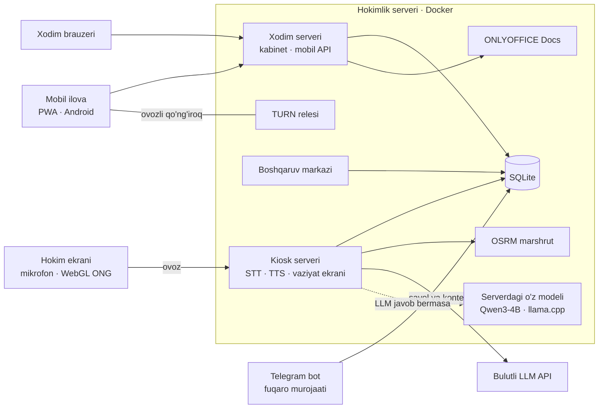

- **Uchta server, uchta nomlar fazosi:** kiosk (`/api/*`), xodim kabineti va mobil API (`/x/*`), boshqaruv markazi (`/a/*`). Caddy ularni ikki domenga taqsimlaydi.
- **Kiosk paroli Caddy darajasida:** vaziyat ekrani faqat parol bilan ochiladi, server esa faqat ruxsat ro'yxatidagi statik fayllarni beradi.
- **Kontekst keshi:** o'zgarmas ma'lumot so'rov boshida, tez o'zgaradigani oxirida turadi. Shu tartib bulutli modelda ham, serverdagi modelda ham keshdan foydalanishga imkon beradi.

## Sifat

Bu ko'rgazma uchun sinovlar ishga tushirilmadi: tizim faqat serverda ishlaydi, mahalliy nusxa ko'tarilmaydi. Ishlab chiqishda tekshiruv staging serverida, masofaviy brauzer orqali o'tkaziladi.

## Texnologiyalar

Python 3 (stdlib HTTP serverlar) · SQLite · Vosk (o'zbek, rus, ingliz) · edge-tts · vanilla JavaScript + WebGL · ONLYOFFICE Docs · OSRM + OpenStreetMap · llama.cpp (Qwen3-4B) · Android (Kotlin) + PWA · o'z TURN relesi · Docker + Caddy · Telegram Bot API

## Jonli

🌐 [gulnoza.geonazorat.uz](https://gulnoza.geonazorat.uz) — ochiq sahifa va ilovani yuklab olish. Vaziyat ekrani va kabinet parol bilan himoyalangan.

---

**Manba kodi yopiq.** Namoyish yoki hamkorlik bo'yicha: Telegram [@Humoyun_Davronov](https://t.me/Humoyun_Davronov)

Muallif — Humoyun Davronov

